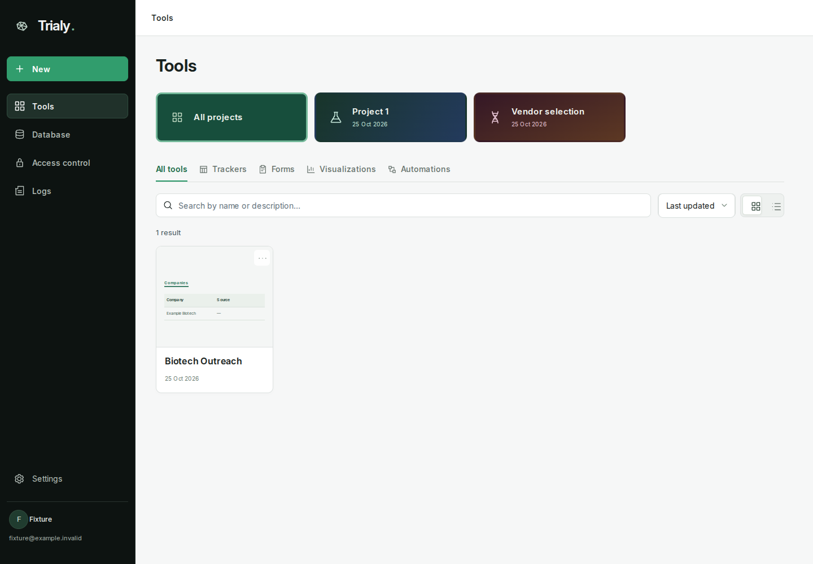
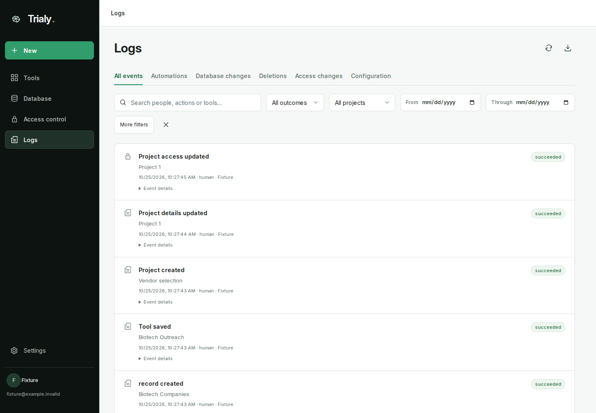
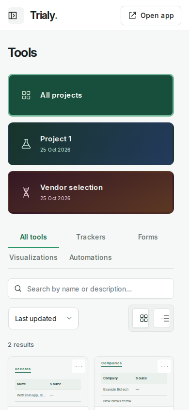

# TrialAgents brand refresh — 25 October 2026

The web app and ChatGPT workspace load `src/shared/ui/brand.css` after the existing component styles. The embedded build includes exactly the same stylesheet. Use this shared brand layer for fixed platform UI; generated tracker content retains its own established rendering contract.

## Visual rules

- Near-black navigation (#0d1311), neutral canvas (#f6f7f7), white panels, dark neutral text (#182220). Green (#299667) identifies actions and selection.
- Page headings use a consistent 40px line box and 28px bottom spacing (24px on small screens). Database and Logs have no descriptive subtitle.
- Categories and Settings sections use underline tabs. Search, selectors and action buttons use 8px rectangular corners. Status metadata uses compact, non-interactive pills with semantic colors.
- Tool cards use neutral borders; existing project identity gradients and the selected project's plain green treatment remain.
- On narrow content widths, categories use three columns over two rows. Labels remain readable. The embedded sidebar overlays small screens and closes on navigation, New and Open app.

## Behavior

- Plugin New sends a user message through the existing MCP App bridge asking ChatGPT to ask what to build or suggest ideas. Errors are shown instead of claiming a message was sent.
- App New explains trackers, forms, visualizations, dashboards and automations, and that saved tools become instantly available in the app with shared data.
- Access control sits below Database. The app lists the current owner and colleagues, allows explicit saves of role, table/field restrictions and ChatGPT access using existing owner-only APIs, and preserves their audit behavior.
- The plugin's Access control page links directly to the signed-in owner page. It does **not** edit account permissions in ChatGPT: the existing backend explicitly requires a human owner session. No origin conversion or authorization relaxation was added.

## Validation

Production build and TypeScript checks; all 75 backend tests; production-bundle Chromium checks with synthetic data for both surfaces, role persistence, New bridge messages, sidebar closure, database editing, and two-row mobile filters. Screenshots below are synthetic fixtures, not customer data. Actual ChatGPT host delivery and production deployment remain unverified.

