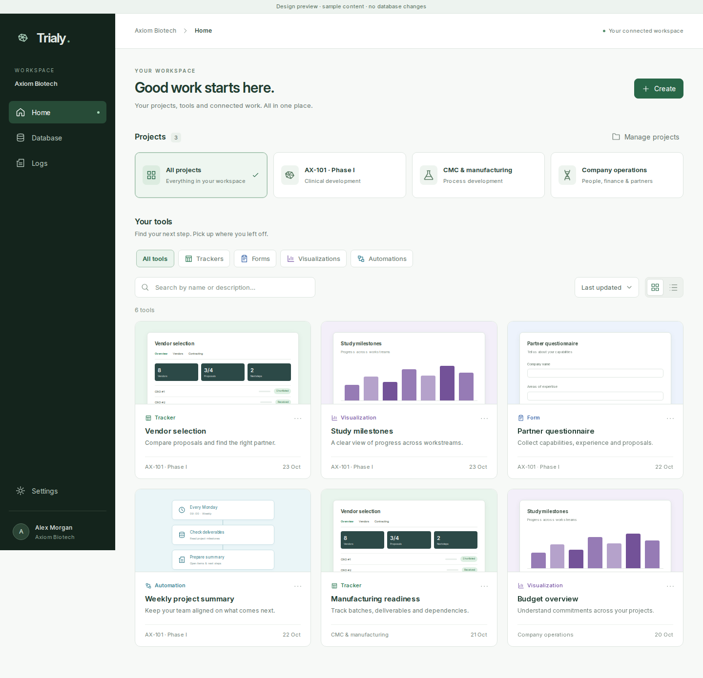

# Home redesign: implementation foundation

Scope: [issue #11](https://github.com/tarous89/trialy/issues/11).

The approved navigation is Home, Database, Logs and account Settings. The user explicitly removed the proposed Needs review entry and deferred review inbox. Discuss/authorize changes during the active action, report the actual result and keep completed activity in Logs. Automation failures belong in Logs. This UI foundation adds no new write authority and does not disable existing server authorization checks.

## Implemented in this first change

- Shared, scoped React presentation components in `src/shared/ui`: branded shell, consistent SVG icons, buttons, search, select, keyboard-accessible action menus, project banners, type filters and Home resource cards.
- Controlled Home state for project/type/search/sort/layout, allowing the connected controller to preserve context across navigation.
- Four resource identities: emerald trackers, blue forms, violet visualizations and cyan automations.
- Preview grid and detailed list; responsive app/sidebar and initially collapsed embedded drawer, empty/loading/error states and focus return.
- Self-hosted variable Inter with its OFL license. The new stylesheet is isolated from generated resource frames and existing application styles.
- Development-only fixture `design-preview.html`, using explicit synthetic content. It imports the reusable presentation components; miniature tracker/form/chart/automation illustrations are fixture code, not production thumbnails.

The application entry points are deliberately not switched to the new components in this first change. This is implementation foundation plus a runnable visual acceptance fixture, not a live connected Home/Database/Logs release. Create, management and secondary-destination fixture actions identify themselves as navigation demonstrations. They do not pretend to save or read production data.

## Visual reference

Uses Intel's forest navigation, restrained green controls, Inter typography, spacing and card treatment, together with Trialy's approved Theme 2 tracker reference. Custom tracker styling remains independent.

[Detailed list](home/home-list.png) · [Narrow embedded layout](home/home-mobile.png)

## Run and verify

`npm run dev:ui`, then open `/design-preview.html`; append `?embedded=1` for the embedded shell.

Run `scripts/test-home-design.ts` using `node --import tsx` with `PLAYWRIGHT_IMPORT` pointing at an installed Playwright module and `CHROMIUM_PATH` at Chromium. Optional `HOME_SCREENSHOTS` saves screenshots. The harness starts/closes its own local Vite server, uses synthetic data and verifies:

- Home/Database/Logs/Settings with no Needs review entry;
- project/type/search combination, sorting and empty states;
- grid/list and return-state retention;
- menu/drawer keyboard focus and Escape;
- 390px embedded layout without page overflow;
- actual loading of the self-hosted font and no page exceptions.

TypeScript and production build pass. These checks are presentation acceptance, not authenticated API or real ChatGPT-host acceptance.

## Remaining integration

1. Build the authorized unified metadata controller for components, published forms and automation entities, preserving legacy resources and avoiding duplicate cards. Implement bounded project search/resource pagination and persisted per-user view preferences. Wire opening/creation to real actions, and ensure filters resolve unsaved work correctly.
2. Supply bounded permission-aware read-only previews; never execute automations for thumbnails. Include revision/access invalidation and a safe fallback. Adapt font delivery to the existing self-contained embedded build/CSP when the shell is wired.
3. Connect Database and replace the sidebar entry points in both surfaces. Retain documents, permissions and configuration through contextual actions. Migrate the current human-confirmation handoff to the approved in-the-moment flow deliberately, rather than merely removing checks.
4. Implement the unified permission-filtered Logs API, durable event coverage, cursor filters and complete filtered CSV export. Automation failures stay here, without a new notification center.
5. Run authenticated app and real-host acceptance before deployment of the connected redesign.
