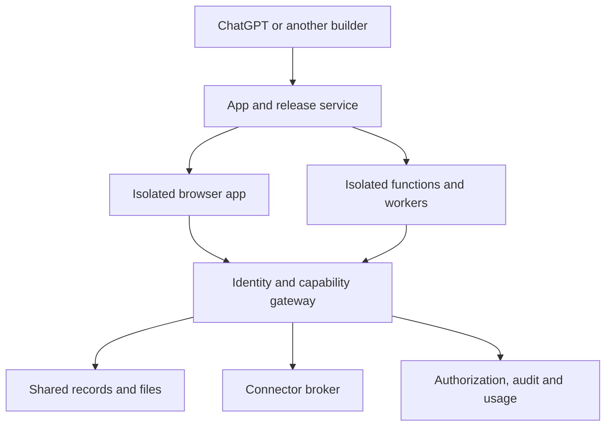

# Trialy app platform scope

Date: 29 October 2026. Status: scoped for implementation; no runtime changes shipped by this document.

Baseline inspected: `main` at `50dda3387b5eb7c02ade7cca900df210972004c4`. The repository and development name remain Trialy. A future Trialegions brand/domain change is outside this change.

[Implementation sequence](APP_PLATFORM_ROADMAP.md) · [Connectors and usage](CONNECTORS_AND_USAGE.md) · [Current frontend](../FRONTEND_CODE.md) · [Current execution](../EXECUTION.md)

## 1. Product decision

Trialy provides the shared data, identity, access enforcement, audit history, hosting and execution behind apps built through conversation. Users describe what they need. ChatGPT or another supported builder produces the interface and code without asking them to choose tracker, form, dashboard or automation.

One app may combine tables, forms, charts, documents, calculations, several screens, background jobs and external service calls. Templates are editable starting points. A new interaction or layout must not require permission to depart from a template or be rejected because it has no category.

The target is broad code compatibility: ordinary browser applications and isolated server programs, including dependencies, endpoints and workers. Implementation must expand beyond the existing HTML render/event interpreter. Renaming that interpreter an app platform does not deliver this scope.

“Whatever code can run” is a direction for compatibility, not a claim that all languages, operating systems, privileged processes or unlimited compute are supported today. Publish runtime versions, supported dependencies and measured limits. Constraints should describe actual execution or resource limits, never an approved list of business use cases. Add runtime adapters over time without introducing new user-facing app categories.

## 2. User experience

- Home contains named apps, with search, sorting, optional tags and optional project grouping. Existing tools become apps in place; names and links survive. Avoid an additional Tools versus Apps distinction in the interface.
- Creation starts with “Describe what you need.” Template suggestions are optional and selected by fit. An app can start empty or evolve from a template without recreating its data.
- An app owns its internal navigation. A calculator, collaboration space, research portal and vendor app have equal standing. Multiple pages and ordinary links are baseline behavior.
- Projects organize apps and related work. Independent apps are allowed. Moving an app must not silently change data scope, sharing or execution authority.
- App settings expose name, sharing, versions, connections, background activity and usage as relevant. Platform identity, effective access, spending approvals and saved status remain trustworthy outside generated content.
- Source and technical diagnostics are available to authorized builders, but end users normally interact with the app. Removing source from the primary interface does not make browser JavaScript secret; credentials and confidential server logic stay server-side. Human access and AI source/data disclosure remain separately enforced.
- Preview, saved draft and published revision are distinct. Publishing activates the chosen version and only its separately authorized capabilities. Restoring source does not restore revoked authority.

Example: a “Development Co-lab” app has a home page, shared projects, members, discussion records, a budget calculator and scheduled progress summaries. These are screens and behaviors of one app. Users never classify each screen before it can be built.

## 3. Verified starting point and gaps

This is a source inspection, not a fresh deployment or production acceptance test. See the current contracts for exact limitations.

| Area | Already present | Change needed |
| --- | --- | --- |
| Saved interfaces | Generic components, revisions, data bindings, assets and custom `frontend-js` | General app package/release contract and neutral creation path |
| Home | Generic components appear under All tools | Remove mandatory four-type creation/filtering and type-based appearance assumptions |
| Frontend | QuickJS returns HTML/CSS/state; a trusted template has local interactions | Real isolated browser JavaScript, packages, assets and local state/navigation |
| Server code | Bounded synchronous JavaScript/WASM, no dependencies/network | Isolated Node/TypeScript and Python tasks, async I/O, packages and endpoint dispatch |
| Navigation | Host selection and custom state changes | Stable app/page/record links, history, refresh, cross-app linking and host adaptation |
| Identity | Signup/login, sessions, MCP OAuth/PKCE, revocation, MFA code | Reusable app identity SDK, app audiences/guests and verified recovery/onboarding |
| Background execution | Leased queue, cancellation, saved revisions, interval/daily schedules and record/document events | General cron, durable workflows, richer events, fair execution and service lifecycle |
| Data and history | Shared records, reviewed writes, explicit grants, field history, effective access | Apply the same boundaries across all runtimes, jobs, routes and connector effects |
| Connections | Account settings list inbound applications authorized to access Trialy | Outbound connector registry, credentials, bindings, OAuth flows and usage |
| Operations | Render web/worker/Postgres and operational groundwork | App build/storage service, execution isolation, usage budgets, recovery and release gates |

Evidence: [resource kinds](../../src/workspace/resource-contract.ts), [Home query](../../src/workspace/home.ts), [Home UI](../../src/shared/ui/HomeView.tsx), [frontend contract](../FRONTEND_CODE.md), [execution contract](../EXECUTION.md), [schedule schema](../../src/foundation/schema.ts), [worker](../../src/foundation/worker.ts), [authentication](../../src/server/auth.ts), [current connections](../../src/web/Connections.tsx).

Account authentication therefore is not missing. What is missing is a supported way for generated apps to use identity and define their own collaboration experience. Likewise, scheduling and events need extension and integration, not a second independent scheduler.

## 4. App contract and shared infrastructure

Retain one stable app identity and append-only revisions. Add a versioned package contract which can describe source files, assets, dependency locks, entry points, routes, functions, jobs, endpoints, data bindings, connector bindings and resource limits. These are internal capabilities, not product categories. Source package, build result and active release are separate records.

Proposed additions, finalized through additive migrations:

| Object | Purpose |
| --- | --- |
| App/revision | Existing component identity plus name, optional project/tags and immutable package version |
| Build/artifact | Content hash, toolchain version, dependency lock, validation results and immutable output |
| Release | Active artifact, environment, routing and rollback metadata |
| Capability binding | Explicit data/action/connector scope and current authorization references |
| Job/run/trigger | Extend existing functions/runs/schedules rather than create a competing engine |
| Connector/connection | Operation definitions versus a tenant's authorized credentials |
| Usage/reservation | Trusted measured quantities and atomic spending reservations |

Data declarations remain independent from presentation labels. A dashboard can acquire editing capabilities through an explicit reviewed change. A calculator with no persistent records needs no artificial table. A data-connected app must have explicit read/write scope even if its old kind was `generic`; removing categories must not remove validation.

Keep shared business data in the governed database and durable files in governed file storage. Temporary browser state and scratch files are allowed. New databases or persistent volumes that bypass shared data, access and audit guarantees are not part of this scope. Backend packages needing SQL should use a compatible governed adapter where feasible, not receive the platform database password.

## 5. Navigation and browser applications

Provide canonical standalone routes such as `/apps/{appId}/{pagePath}` and a host-neutral route descriptor `{appId, path, params}`. Support nested routes, record detail links, relative links, query state, refresh, bookmarks, back/forward, missing pages and permission-denied pages. Route parameters contain identifiers and non-sensitive state, not access tokens or copied records.

App links select a destination, never grant access. Cross-app links and direct record URLs recheck the current identity, app membership and data permissions. Do not leak inaccessible destination names or snapshots. External links use a deliberate external-navigation action; ordinary internal links must not be stripped as unsafe HTML.

Standalone history can use browser history APIs. ChatGPT/other embedded hosts get an adapter with app-local history and a trusted open-in-app link; an iframe cannot assume control over the host's address bar. Refresh or reopen must restore the intended route where the host supplies it. Measure both experiences separately.

Add a browser bundle runtime alongside the existing interpreter. Initial support: multi-file HTML/CSS/JavaScript/TypeScript, React and compatible bundled npm dependencies, normal DOM interactions, SVG/canvas and static assets. Pure navigation, typing, sorting and calculations run locally. Fetch shared data only when needed. Separate-origin sandboxing and a narrow SDK bridge protect the parent, account cookies and other apps.

Run builds and package install scripts as untrusted code in isolated, bounded build environments. Pin dependency versions, retain lockfiles and artifact hashes, limit downloads/output, scan dependencies and provide a patch/rebuild process. Never execute package installation or generated Node code inside the trusted web server. Bundle assets rather than requiring arbitrary runtime CDN scripts. New runtime access such as web workers, WebSockets or device features requires an explicit technical capability and compatible host support, not a new app type.

The SDK supports identity, routing, governed data/files, reviewed writes, jobs, connectors and status. Permission enforcement, exact approvals and billing take place on trusted services. A generated Save button or credential prompt alone cannot authorize hidden effects. Existing human/AI boundaries and longer-term data-type grants continue to apply.

## 6. Server functions, endpoints and workers

Introduce a provider-independent execution interface for build, invoke, cancel, status, logs, artifacts and resource metering. Keep the existing QuickJS adapter for simple/legacy workloads. Add Node/TypeScript and Python with locked packages in per-run isolated environments. Set explicit CPU/memory/wall-time/output/storage/network limits; these are adjustable platform tiers, not one fixed 15-second ceiling for every app.

Runtime environments receive short-lived app/run capabilities and scratch storage, never control-plane database credentials or owner-level tokens. They access shared data through the gateway and external services through authorized connectors. Network controls must actually prevent bypass of those brokers. No privileged containers or host mounts are required to satisfy ordinary application code.

Expose declared HTTP handlers behind a trusted gateway with authentication, route validation, quotas and request limits. Execute short handlers as invocations; return a job handle for long work. Generic inbound webhooks are supported after signature/credential checks and replay protection. App access and billing attribution remain explicit even for a public endpoint.

Workers and automation are core capabilities. Extend the current queue and triggers to provide cron/time zones, delayed jobs, durable multistep workflows, checkpoints, cancellation, retries/backoff, dead-letter handling, concurrency controls and execution history. A worker runs when ChatGPT and the browser are closed.

Use at-least-once delivery with durable deduplication and operation receipts. External effects may have an unknown outcome after a timeout; they must be reconciled before retry when the provider cannot guarantee idempotency. Do not promise exactly-once external effects. Data commits and event outbox entries should be atomic. Event chains need causal IDs and bounded depth so legitimate workflows work without uncontrolled loops.

Long-lived queue consumers or app processes require a separately metered service lifecycle: deploy/start/stop, health checks, restart policy, resource limits and graceful shutdown. They are a planned runtime extension, not falsely represented as an ephemeral function. Do not create one always-on Render service or cron service for every user app by default.

## 7. Identity, sharing and collaboration

Use Trialy's existing authentication as the identity foundation. Supply generated apps with the current user, permitted app membership and scoped actions. ChatGPT can design onboarding, member lists and app-specific roles/workflows using reviewed policies. It must not invent password storage or let client-side role labels override backend policy.

Ship existing-account private/team apps first. Add invite-only external collaborators with verified identity, revocation and explicit data scope. Public signup and additional identity providers can follow on the same contract. Decide whether identity is shared across a tenant's apps or an invited audience; never implicitly make an external member an account administrator.

Support separate app membership and data/action permissions. A collaboration app may require owner-only/private records: add explicit reviewed record-scope rules if current enforcement cannot express them. Hiding a row is insufficient. Do not claim a private portal works until direct reads, queries, exports, jobs and links enforce the same scope.

Concurrent edits use versions and conflict recovery. Add permission-filtered subscriptions/polling for shared updates; revocation removes future updates and cached sensitive views. Real-time presence and collaborative document editing are later enhancements, not prerequisites for a shared multi-user app. Preserve the existing patient-level data exclusion unless separately changed by the user.

## 8. Connectors and economics

Build a generic connector broker and secure connection flow before a large provider catalogue. The first connector supports ordinary HTTPS services, reviewed operations, scoped credentials and metered execution. Provider-specific email, Microsoft 365 and AI connectors are later adapters on this same mechanism. Generic connectivity should not wait for those adapters.

Use “Connectors” in the product. Prompt for a connection only when needed, and offer a compact management page for status, app access, usage and revocation. Credentials are entered in trusted UI, not pasted into chat or generated code. MCP exposes capability and connection metadata, never secret values.

Some connectors use a customer's account; others can be paid for by Trialy. Customer-supplied service charges are billed by that provider; Trialy meters its own execution. Trialy-funded operations require verified pricing, atomic spending controls and usage reconciliation before activation. Details and a cost formula are in [Connectors and usage](CONNECTORS_AND_USAGE.md).

## 9. Delivery boundaries

| Delivery milestone | Included | Explicitly later |
| --- | --- | --- |
| A: Unified apps | Neutral Home, migration, app revisions, routes/internal links, identity/data SDK and existing template/custom-runtime compatibility | New browser/server compatibility is not claimed yet |
| B: Programmable apps | Real browser bundles; isolated Node and Python tasks; server handlers; team/invite-only collaboration after identity checks; durable jobs/cron/events; generic connector; metering and limits | Provider catalogue and platform-funded email/AI |
| C: Expanded runtime | Long-lived services; broader OCI/runtime compatibility; public signup/federation and additional protocols as required | GPU/privileged workloads and unbounded hosting are not launch promises |
| D: Managed services | Selected email/document/AI adapters, managed credentials, tariffs and provider operations | Broad marketplace and every possible third-party integration |

Milestone B is the first release that can substantiate the broader programmable-app proposition. A alone is a useful migration but is insufficient to claim general code hosting. Roadmap steps include the engineering decision points and release acceptance criteria.

## 10. Trade-offs and preserved value

Preserve shared data, history, permissions, templates, existing apps and code revisions. The change does not require abandoning the standard renderer. Standard tools retain its speed and layout editor; custom apps can reuse its components without matching its layout.

Broad execution adds build infrastructure, isolation, dependency maintenance, debugging, performance variance, cost attribution and recovery work. Template changes cannot automatically fix unrelated custom code; platform SDK and runtime versions need compatibility windows. App rollback restores code and configuration only, not past records or completed external effects. Treat data migrations separately.

Avoid committing to unlimited arbitrary code before the browser/server runtime and cost controls exist. Offer broad freedom within clearly stated runtimes and expand based on real apps. The durable product advantage remains shared governed data, reusable identity, visible history and managed operation across all those apps.

## 11. External technical references

Checked 29 October 2026; provider details must be rechecked during implementation.

- [Render Sandboxes](https://render.com/docs/sandboxes): candidate for isolated builds/tasks. Public beta; the current documentation lists no public application URLs, no private networking and no generally available credential brokering. It is not by itself a complete app hosting or connector solution. Keep the control plane, frontend delivery and connector broker separate; evaluate suitability before choosing it.
- [Render background workers](https://render.com/docs/background-workers) and [cron jobs](https://render.com/docs/cronjobs): infrastructure building blocks; application schedules should normally share the existing scheduler/queue.
- [MDN browser history](https://developer.mozilla.org/en-US/docs/Web/API/History_API/Working_with_the_History_API): standalone route/history behavior; embedded hosts require their own adapter.
- [OWASP authorization](https://cheatsheetseries.owasp.org/cheatsheets/Authorization_Cheat_Sheet.html): server enforcement on each request. This supports the shared gateway boundary, not UI-only permission checks.
